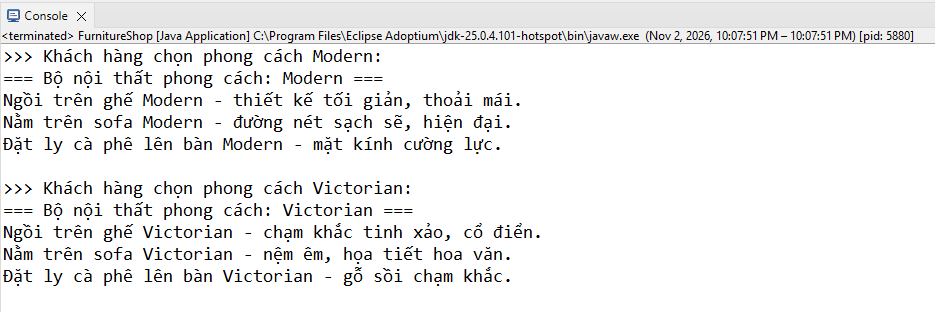
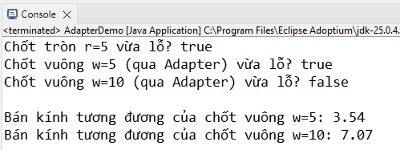
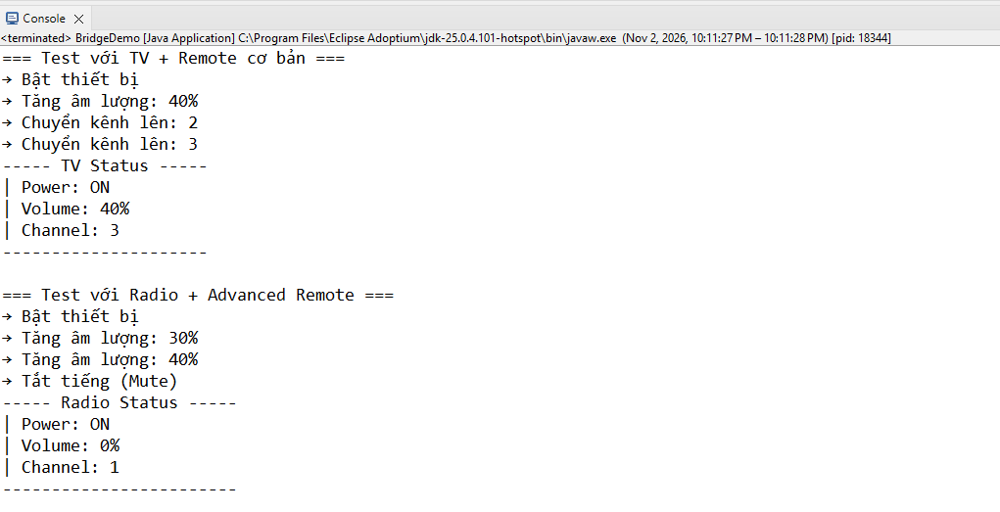
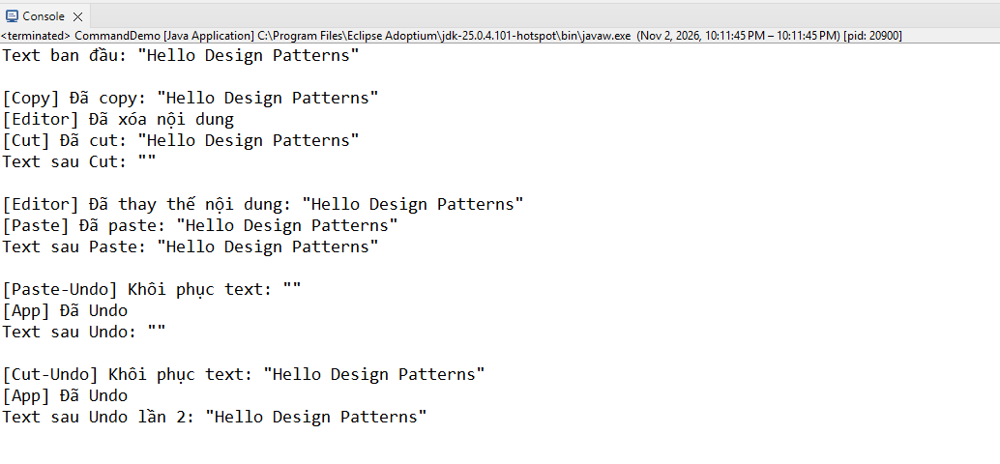
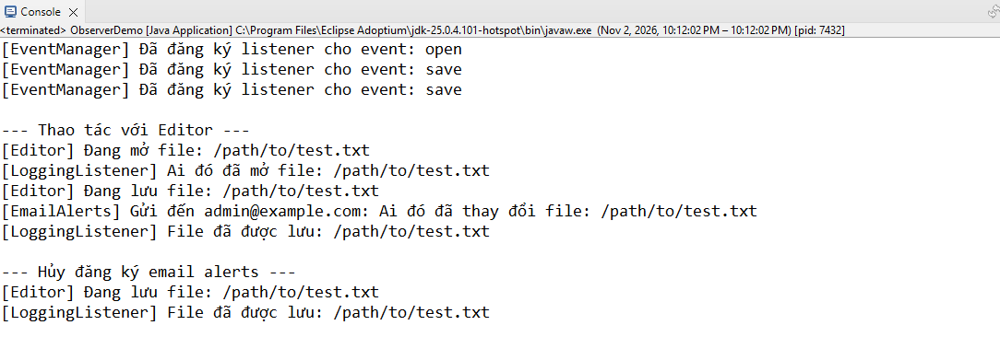

# Design Patterns Examples - Eclipse Project

Bộ ví dụ Java cho 5 mẫu thiết kế:

| Package           | Pattern          | Class chính để chạy  |
| ----------------- | ---------------- | -------------------- |
| `abstractfactory` | Abstract Factory | `FurnitureShop.java` |
| `adapter`         | Adapter          | `AdapterDemo.java`   |
| `bridge`          | Bridge           | `BridgeDemo.java`    |
| `command`         | Command          | `CommandDemo.java`   |
| `observer`        | Observer         | `ObserverDemo.java`  |

## Cấu trúc thư mục

```
DesignPatternsExamples/
└── src/
    ├── abstractfactory/   ← Abstract Factory (Furniture)
    ├── adapter/           ← Adapter (SquarePeg → RoundHole)
    ├── bridge/            ← Bridge (Remote + Device)
    ├── command/           ← Command (Text Editor + Undo)
    └── observer/          ← Observer (Editor Events)
```

Kết quả mong đợi
Abstractfactory



Adapter


Bridge


ommand


Observer

